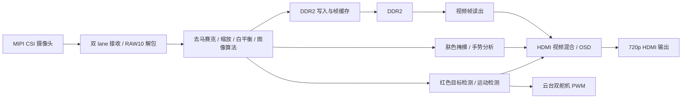

# FPGA 摄像头实时目标检测与二轴云台指向系统

这是一个面向 Tang Dynasty FPGA 平台的完整摄像头视觉处理工程。工程以 PH1P35MDG324 FPGA 为目标器件，接收 MIPI CSI 摄像头图像，完成图像处理、目标检测和视频缓存，再通过 HDMI 输出；同时包含运动检测框、手势分析、OSD 和双路舵机 PWM 控制。

## 系统功能

- MIPI CSI 双 lane RAW10 摄像头接收和数据解包。
- Bayer 去马赛克、图像缩放、自动白平衡及曝光/增益控制。
- RAW 图像诊断、图像算法模式切换和边缘阈值控制。
- 红色目标检测、坐标提取及云台水平/俯仰控制。
- 基于帧差的运动检测、稳定包围框和 HDMI 检测框显示。
- 基于肤色掩模的手势分析与时间投票。
- DDR2 视频帧缓存、720p HDMI 时序生成、视频混合及 OSD。

## 系统架构



工程顶层为 `design_top_wrapper`，位于 `user_source/hdl_source/design_top_wrapper.v`。顶层连接时钟与复位、摄像头接收、ISP、检测与手势处理、DDR2 控制、HDMI 输出以及舵机接口。核心图像处理模块位于 `user_source/hdl_source/isp/`；手势处理模块位于 `user_source/hdl_source/hand_gesture/`。

## 运行模式

开关 `0/1` 表示 FPGA 读取到的逻辑电平，物理拨杆方向请以目标板卡丝印和原理图为准。

| SW3 | SW1  | 图像与检测模式             | 舵机行为                     |
| --- | ---- | -------------------------- | ---------------------------- |
| 0   | 任意 | 红色目标跟踪               | 根据红色目标坐标输出云台 PWM |
| 1   | 0    | 运动检测，显示红色运动框   | 红色跟踪输出关闭             |
| 1   | 1    | 运动检测与手势分析同时运行 | 红色跟踪输出关闭             |

SW4 控制 HDMI OSD 显示。按键功能如下：

| 输入   | 功能                                    |
| ------ | --------------------------------------- |
| 按键 1 | 循环切换图像算法模式                    |
| 按键 2 | 增加边缘检测阈值档位                    |
| 按键 3 | 根据 SW2 调整自动曝光目标级别或手动增益 |
| 按键 4 | 循环切换诊断图像模式                    |
| SW2    | 选择自动曝光目标调整或手动增益调整      |
| SW4    | 开启/关闭 OSD，包括检测框               |

图像算法模块支持直通/色彩增强、灰度、阈值、反色、红色增强、Sobel 边缘、卡通和直方图均衡等模式。诊断模式和具体图像格式以工程 RTL 实现为准。

## 运动检测

运动检测模块位于 `user_source/hdl_source/isp/target_detect_track.v`，内部的 `motion_grid_stable` 对 1280×720 图像进行网格采样，并基于相邻帧亮度差生成单个运动包围框。当前参数包括运动阈值、邻域抑噪、最小有效网格数、框边缘平滑、短时漏检保持和全局亮度突变抑制。

该检测器用于固定摄像头下的运动区域提示，不是静止目标跟踪器。多个运动区域可能合并为一个框；目标停止后检测框会消失。小目标、低对比目标和很窄的运动边缘可能漏检，明显的全局画面变化也可能触发抑制逻辑。

## 硬件与开发环境

- FPGA 器件：PH1P35MDG324，速度等级 -3。
- FPGA 工具：Tang Dynasty IDE 6.2；工程记录版本为 6.2.200067。
- 仿真工具：ModelSim SE 10.5。
- 仿真脚本运行环境：Node.js。
- 板级外设：与约束匹配的 MIPI CSI 摄像头、DDR2、HDMI 显示器；舵机控制需连接兼容的云台舵机。

板级引脚和时序约束位于 `user_source/constraints_source/`，DDR2 控制器、时钟和厂商 IP 也由工程一并引用。使用不同板卡或摄像头时，应先检查引脚、电气标准、时钟、CSI lane 配置及传感器初始化参数。

## 工程目录

```text
td_project/                         Tang Dynasty IDE 工程、约束和实现输出
user_source/                        工程 HDL、IP、约束及板级模块
  hdl_source/                       顶层、视频链路、ISP、DDR/控制和仿真源码
  ip_source/                        PLL、FIFO、RAM、MIPI 等 IP 工程文件
  constraints_source/               引脚与时序约束
  hdl_source/hand_gesture/          手势识别 RTL 与仿真
  hdl_source/isp/                   ISP、目标检测 RTL 与仿真
validation_motion_v3/                构建、展开检查、仿真脚本及生成结果
BUILD_RESULT.md                     一次实现构建和仿真的结果记录
```

以上是当前工程的组织方式。源码保持在现有目录中，Tang Dynasty 工程通过项目文件引用这些路径。

## 获取和打开工程

```powershell
git clone <仓库地址>
cd <仓库目录>
```

在 Tang Dynasty IDE 中打开：

```text
td_project/camera_720p_v1.al
```

工程文件可能包含创建机器上的绝对路径。若 IDE 在新环境中无法找到源码，请使用 IDE 的路径重定位功能，或在工程中重新关联现有源码目录；不要将源码移动出 `user_source/`，因为工程文件和构建流程按现有相对目录组织。

## 构建

在工程根目录运行 Tang Dynasty 命令行工具。请根据本机安装位置修改可执行文件路径：

```powershell
& 'D:/TD_IDE/bin/td_commands_prompt.exe' validation_motion_v3/build.tcl
```

该脚本打开 `td_project/camera_720p_v1.al`，以 `design_top_wrapper` 为顶层，加载器件、引脚和时序约束并执行综合、布局布线及 bitstream 生成。

验证工程展开和顶层模块绑定：

```powershell
& 'D:/TD_IDE/bin/td_commands_prompt.exe' validation_motion_v3/verify_project.tcl
```

## 仿真

运行九项 ModelSim 回归：

```powershell
node validation_motion_v3/run_sim.cjs 'C:/FPGA_SoftWare/ModelSim_10.5se/win64'
```

如果 ModelSim 安装路径不同，将参数替换为包含 `vlog.exe` 和 `vsim.exe` 的 `win64` 目录。省略参数时，脚本使用上述默认路径。回归覆盖运动检测、手势处理、HDMI OSD、红色目标检测及完整检测控制链路；日志和汇总写入 `validation_motion_v3/sim/`。

## 已记录的实现结果

`BUILD_RESULT.md` 记录的一次 PH1P35MDG324（-3）构建已完成综合、布局、布线和 bitstream 生成。报告中的资源为 Slice 18,619/21,216、ERAM 60/108、DSP 36/40；最终建立时间 WNS 为 +0.001 ns，保持时间 WNS 为 +0.020 ns。该建立时间余量较小，结果对应记录时的工具、约束和工程状态。修改源码或工具版本后，应重新构建并检查时序报告。

记录中的九项 ModelSim 回归均通过。仿真使用合成激励，仍需在实际摄像头、显示器和目标板上验证图像效果、检测表现、接口兼容性及端到端运行情况。

## 项目文件说明

工程包含 Verilog/SystemVerilog 源码、Tang Dynasty 工程和约束文件、IP 文件、仿真脚本，以及已有构建生成物。不同文件可能由项目作者或 FPGA/IP 工具生成；查看具体文件时，可根据其目录和文件头识别对应模块及来源。
